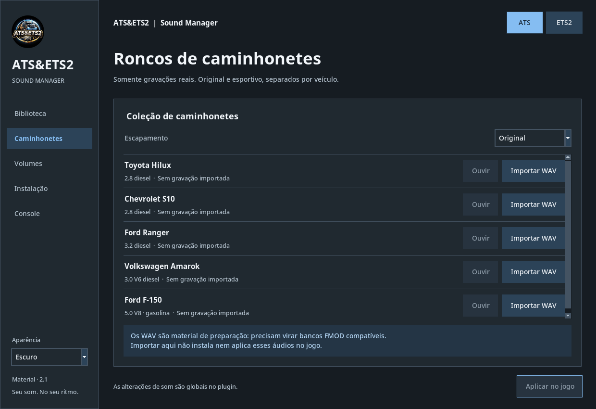

# soundpack — ATS&ETS2

Gerenciador de pacotes de som com temas **Claro e Escuro**, acompanhado da pasta `ts-fmod-plugin` enviada para este pacote.

## Download completo

Baixe **soundpack-completo-v2.1.0.zip** na seção [**Releases**](https://github.com/stephansantos250-spec/soundpack/releases/latest). O código-fonte do repositório não inclui os bancos de áudio; o ZIP completo inclui.

## Conteúdo do ZIP

```text
soundpack/
├── aplicativo/             # App Python, scripts de execução e geração de EXE, logo e ícone
├── ts-fmod-plugin/         # 97 bancos .bank e arquivos complementares enviados pelo usuário
├── ts-fmod-plugin.dll      # DLL incluída no arquivo enviado
├── CONTEUDO_RONCOS.csv     # Inventário e hashes dos arquivos enviados
└── README.md
```

## Instalar no Windows

1. **Feche o jogo. Faça backup** da sua pasta `bin\win_x64\plugins` e de `%APPDATA%\ATS_Pack_Manager`.
2. Extraia o ZIP completo em uma pasta nova.
3. Copie a pasta **ts-fmod-plugin** e o arquivo **ts-fmod-plugin.dll** para `bin\win_x64\plugins` do jogo. A DLL deve ficar ao lado da pasta, não dentro dela. Confira os arquivos antes de substituir os existentes.
4. Abra `aplicativo\1_EXECUTAR.bat`. É necessário Python de 64 bits com Tkinter instalado.
5. Em **Instalação**, selecione a pasta principal do jogo. Na **Biblioteca**, atualize a lista, ouça uma prévia quando disponível, selecione e salve.
6. Para trocar com o jogo aberto, use **Aplicar no jogo** ou `sdk reload` no console. Ative o console com o jogo fechado antes da primeira utilização.

O caminho informado para este pacote foi `F:\SteamLibrary\steamapps\common\American Truck Simulator\bin\win_x64\plugins`. O app também tem seleção de ETS2, mas **não foi verificada a compatibilidade destes bancos e deste master.bank com ETS2 nem com cada versão do ATS**. Não copie para outro jogo sem verificar essa compatibilidade.

## Temas e executável

Em **Aparência**, no canto inferior esquerdo, escolha **Claro** ou **Escuro**. A preferência é salva. Para gerar um executável no Windows, execute `aplicativo\2_CRIAR_EXE.bat`. **Este pacote não inclui um EXE compilado.**



## Sons incluídos e limites

- Os bancos foram fornecidos pelo usuário no arquivo `ts-fmod-plugin.rar`, preservados sem edição de áudio. Não são o pacote sintetizado produzido anteriormente na conversa.
- Não foi verificado se os sons são gravações reais, a motorização exata de cada banco ou sua licença de redistribuição. A quantidade de bancos não significa quantidade de modelos de veículos.
- A aba **Caminhonetes** é um organizador de WAV para preparação. Ela não transforma WAV em .bank nem aplica esses WAV ao jogo. Não foram acrescentadas gravações novas de caminhonetes.
- A seleção do plugin é global; não troca automaticamente por veículo.
- `master.bank`, `effects.bank` e `tires.bank` vieram sem um arquivo `.bank.guids` correspondente. Nem todos os bancos terão prévia no app.
- Sons, DLL e materiais de terceiros mantêm os direitos e créditos de seus respectivos autores. Este repositório não concede uma licença nova sobre eles.
- Projeto do plugin original: https://github.com/dariowouters/ts-fmod-plugin

## Validação

A extração do RAR foi verificada e o ZIP foi conferido por CRC. O inventário inclui SHA-256 dos arquivos fornecidos. A interface e os fluxos locais do app foram testados no Linux com arquivos temporários. **Reprodução, FMOD, DLL, instalação e integração no jogo não foram testados no Windows.** Os binários enviados não foram executados neste ambiente.
